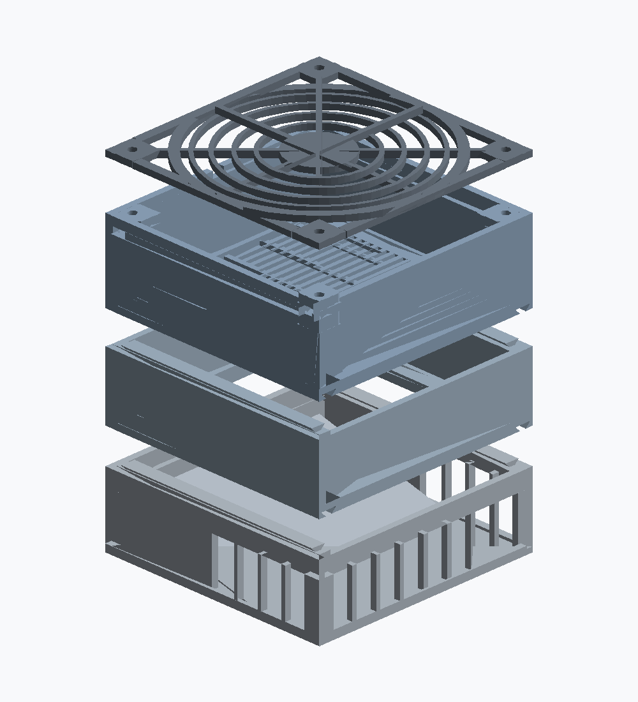
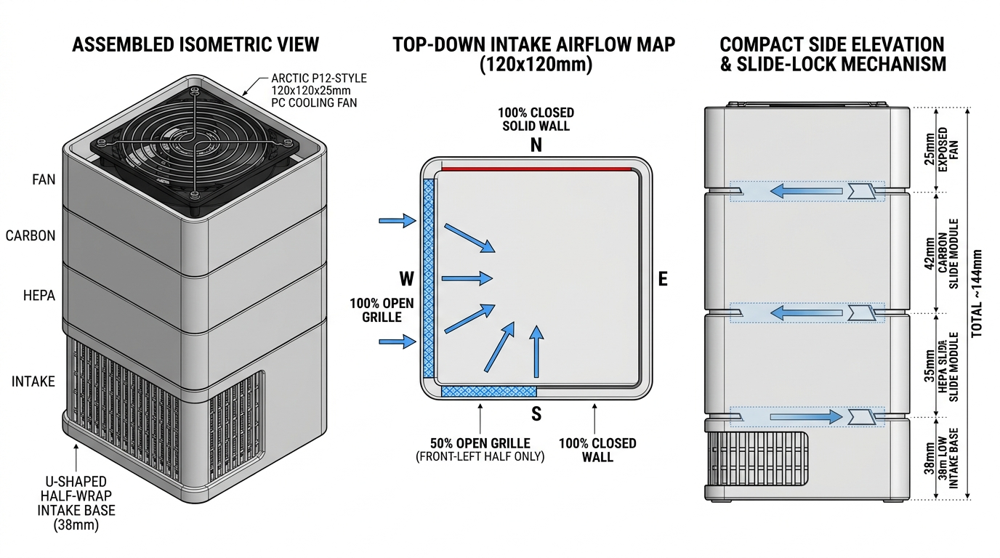
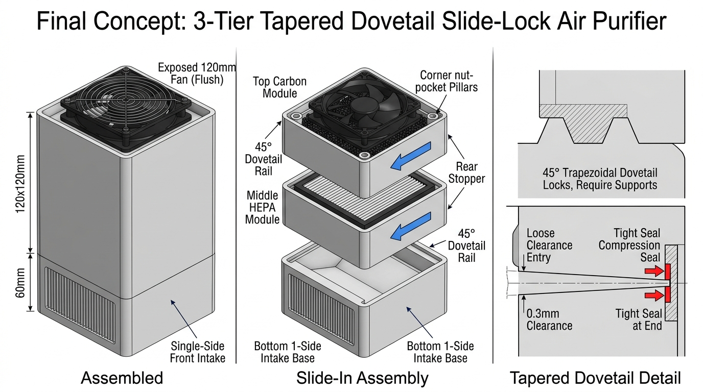
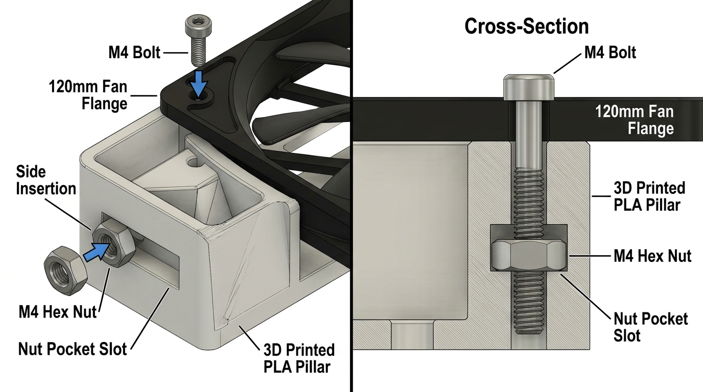

# Air-purifier (Bambu Lab A1 mini용 소형 DIY 공기청정기)

창문 배기 덕트 설치가 어려운 실내 환경에서 **Bambu Lab A1 mini 바로 옆(10~20 cm 이내)**에 배치해 사용하는 소형 **국소 포집** DIY 공기청정기 하드웨어 설계 저장소입니다.

- **외형 치수:** `120 × 120 × ~143 mm` (120mm 팬 상단 노출 Flush 구조)
- **출력 호환성:** A1 mini 빌드 볼륨(`180³ mm`) 대응 — 모든 개별 파트 높이 `42 mm` 이하, **서포트 없음(Support-free)**
- **자재 비용:** 약 ₩24,000 ~ ₩33,000 (필라멘트 제외)

<p align="center">
  
</p>

---

## 1. 설계 이유 (배경 및 결정 근거)

- **창문 배기 덕트 대체 (국소 포집):** 챔버 이용 없이 창문형 배기 덕트를 설치하면 실내 단열이 저하되므로, 프린터 바로 옆(`10~20 cm`)에서 미세먼지(HEPA)와 VOC/냄새(활성탄)를 즉시 빨아들이는 국소 포집 형태로 설계했습니다.
- **프린터 옆 배치 선택 (Z축 상단 거치 제외):** A1 mini는 Z축 기둥이 한쪽에만 있는 외팔보(캔틸레버) 구조여서 상단에 하우징·필터·팬을 매달면 진동·고스팅(Input Shaper 악영향)과 PTFE 튜브 간섭 위험이 큽니다. 프린터 옆에 두면서 **ㄷ자 반절 흡기**로 프린터 방향 유속을 높이는 쪽이 출력 품질과 포집 효율 모두 유리합니다.
- **3단 분할 출력 (A1 mini 최적화):** 일체형 대형 하우징보다 낮은 모듈(최대 `42 mm`)로 분할 출력해야 뒤틀림(워핑) 없이 높은 품질을 유지할 수 있고, 필터 교체도 간편합니다.
- **가성비 및 무납땜 전원:** 여분 부품이 없는 상태에서 최소 비용으로 제작하기 위해 정압 특화 팬(Arctic P12), 범용 자동차용 에어컨 필터, 다이소 M4 볼트·너트(너트 포켓), 15W 보조배터리 + `5V→12V 승압 케이블` 조합을 채택했습니다.

## 2. 핵심 설계 특징

### ① 3단 테이퍼 도브테일 슬라이드-락 (Tapered Dovetail Slide-Lock)
- 외부 돌출 클립 없이 각 모듈 좌·우 테두리에 **45° 테이퍼 도브테일 레일**을 일체형으로 설계했습니다.
- 앞쪽 진입부는 `0.30 mm` 여유로 부드럽게 들어가고, 뒤쪽 스토퍼 끝단으로 갈수록 `0.12 mm`까지 미세하게 좁아지며 위아래가 꽉 밀착되어 **공기 누설을 최소화**합니다.
- 45° 오버행 설계로 **서포트 없이** 깔끔하게 출력됩니다.

### ② 하단 ㄷ자(U-Shape) 반절 집중 흡기 (`38 mm`)
- 프린터 방향(좌측 `-X`) **100% 개방** + 상·하 측면(`±Y`) **앞쪽 50% 개방** + 후면(`+X`) **100% 밀폐** 구조입니다.
- 총 개방 둘레 약 `224 mm`를 확보해 하단 흡기함 높이를 `38 mm`로 슬림하게 유지하면서도 풍량 손실을 줄이고, 내부 경사 배플로 유입 공기를 필터 전체로 분산합니다.

### ③ 상단 120mm 팬 노출 + M4 너트 포켓 관통 체결
- 정압이 높은 **Arctic P12 (`120 × 120 × 25 mm`, `2.20 mmH₂O`)** 팬을 상단 모듈 위에 노출 거치합니다.
- 상단 모듈 4개 코너 기둥의 외벽 측면 슬롯에 **M4 육각 너트**를 눕혀 끼우는 **너트 포켓(Captive Nut)** 방식을 적용해, 인두기나 황동 인서트 없이도 **M4 × 35~40 mm 볼트**로 `보호 그릴 + 팬 + 하우징`을 한 번에 관통 체결할 수 있습니다.

| ㄷ자 흡기 & 전체 컨셉 | 테이퍼 도브테일 원리 | M4 너트 포켓 원리 |
| :---: | :---: | :---: |
|  |  |  |

### ④ 활성탄 선정 주의사항 (필수)
> [!CAUTION]
> 저가 **산세척 활성탄**은 공기 중 수분과 반응해 산성 가스를 방출하며 **리니어 레일과 금속 부품에 녹(부식)을 유발**합니다. 반드시 **무산성 펠릿형 활성탄(3~4 mm)**(네버모어/벤토박스용)을 사용하세요.

---

## 3. 자재 목록 (BOM) 및 전원 설계

| 품목 | 추천 사양 | 예상 가격 | 비고 |
| :--- | :--- | :--- | :--- |
| **쿨링팬** | **Arctic P12** (3핀 또는 PWM 4핀) | ₩9,000 ~ ₩11,000 | 정압 특화 (`2.20 mmH₂O`) |
| **전원 케이블** | **USB 5V→12V 승압 팬 속도조절 케이블** | ₩4,000 ~ ₩6,000 | USB-C 연결 시 C-to-A 젠더(+₩1,000) |
| **HEPA 필터** | 국산차용 초미세먼지/HEPA 에어컨 필터 | ₩4,000 ~ ₩6,000 | 두께 28~30mm 범용, 재단 시 2~3회분 |
| **활성탄** | **무산성(Acid-free) 펠릿형 활성탄** 500g | ₩6,000 ~ ₩8,000 | 3D 프린터 전용 |
| **기밀/체결 부자재** | 얇은 EVA 폼 테이프(문풍지) + **M4×35~40mm 볼트 & 너트 4세트** | ₩1,000 ~ ₩2,000 | 다이소/철물점 구매 |

- **전원 팁:** 15W 보조배터리는 5V/3A 출력만 지원하는 경우가 많아 PD 트리거 대신 **USB 5V→12V 승압 케이블** 사용을 권장합니다.

---

## 4. 3D 출력 가이드 (Bambu Studio / A1 mini)

| 파일명 | 파트 설명 | 외형 크기 (mm) | 권장 출력 설정 |
| :--- | :--- | :---: | :--- |
| [`01_intake_base.stl`](cad/stl/01_intake_base.stl) | 하단 ㄷ자 반절 흡기 모듈 | `120 × 120 × 40.2` | **PLA**, 레이어 `0.20mm` |
| [`02_hepa_module.stl`](cad/stl/02_hepa_module.stl) | 중단 HEPA 필터 수납 모듈 | `120 × 120 × 37.2` | 벽 루프 `3`, 인필 `15~20%` |
| [`03_carbon_fan_module.stl`](cad/stl/03_carbon_fan_module.stl) | 상단 활성탄 + 팬 마운트 모듈 | `120 × 120 × 42.0` | **서포트 OFF (Support-free)** |
| [`04_fan_grille.stl`](cad/stl/04_fan_grille.stl) | 상단 120mm 팬 보호 그릴 | `120 × 120 × 3.0` | 베드 평면 그대로 배치 |

### 조립 순서
1. **너트 삽입:** [`03_carbon_fan_module.stl`](cad/stl/03_carbon_fan_module.stl) 외벽 측면 슬롯 4곳에 **M4 육각 너트**를 평평하게 밀어 넣습니다.
2. **팬/그릴 체결:** Arctic P12 팬(배기 방향이 위쪽)과 [`04_fan_grille.stl`](cad/stl/04_fan_grille.stl)을 올리고, **M4×35~40mm 볼트** 4개로 위에서 관통 체결합니다. 전원 케이블은 후면 상단 노치로 뺍니다.
3. **필터 충전:**
   - [`02_hepa_module.stl`](cad/stl/02_hepa_module.stl)에 재단한 자동차 HEPA 필터를 넣고 테두리에 EVA 폼 테이프를 둘러 기밀을 맞춥니다.
   - [`03_carbon_fan_module.stl`](cad/stl/03_carbon_fan_module.stl) 타공 바닥판 위에 얇은 부직포(분진 방지)를 깔고 무산성 활성탄을 `20~25mm` 두께로 채웁니다.
4. **슬라이드 결합:** 하단 → 중단 → 상단 순으로 45° 도브테일 레일을 따라 뒤쪽 스토퍼까지 밀어 결합한 뒤, A1 mini 좌/우측 옆에 흡기구가 프린터를 향하도록 배치합니다.

### 치수·공차 커스터마이징
필라멘트 수축률에 따라 슬라이드 결합 강도를 조절하려면 [`cad/src/generate_stl.py`](cad/src/generate_stl.py) 상단의 `DT_CLR_F`(진입 여유 `0.30mm`), `DT_CLR_B`(끝단 압착 `0.12mm`) 값을 수정한 뒤 실행하세요:
```bash
python3 cad/src/generate_stl.py
```

---

## 5. 저장소 구조

```text
HW-Air-purifier/
├── README.md
├── .gitignore
├── docs/
│   ├── SPEC.md                          # 상세 설계 명세서
│   └── images/
│       ├── preview_exploded.png         # 실제 STL 메쉬 분해도 프리뷰
│       ├── concept_u_intake.jpg         # ㄷ자 흡기 컨셉 도해
│       ├── concept_slide_lock.jpg       # 테이퍼 도브테일 슬라이드 원리
│       ├── concept_captive_nut.jpg      # M4 너트 포켓 원리
│       └── archive/                     # 초기 설계 비교안 보관
│           ├── option_a_clip_stacking.jpg
│           └── option_b_2piece_tray.jpg
└── cad/
    ├── stl/                             # 출력용 최종 STL 4종
    │   ├── 01_intake_base.stl
    │   ├── 02_hepa_module.stl
    │   ├── 03_carbon_fan_module.stl
    │   └── 04_fan_grille.stl
    └── src/                             # 파라미터 수정용 소스
        ├── generate_stl.py
        └── air_purifier.scad
```
